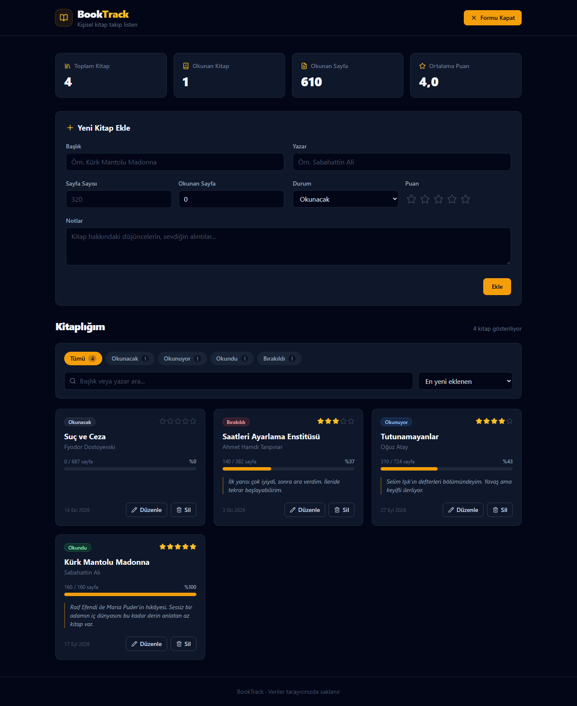

# 📚 BookTrack

Okuduğun, okuyacağın ve yarıda bıraktığın kitapları takip etmeni sağlayan kişisel bir kitap yönetim uygulaması.

🔗 Canlı Demo: [Netlify linki buraya]

## Özellikler

- **Kitap ekleme** — başlık, yazar, sayfa sayısı, okunan sayfa, durum, puan ve notlarla
- **Listeleme** — tüm kitaplar durum rozeti, yıldız puanı ve ilerleme çubuğu içeren kartlarla gösterilir
- **Güncelleme** — aynı form üzerinden kitabın tüm alanları düzenlenebilir
- **Silme** — onay penceresiyle güvenli silme
- **Form doğrulama** — boş başlık/yazar, geçersiz sayfa sayısı ve toplam sayfayı aşan okunan sayfa için Türkçe hata mesajları
- **Filtreleme** — duruma göre (Tümü / Okunacak / Okunuyor / Okundu / Bırakıldı)
- **Canlı arama** — başlık veya yazara göre
- **Sıralama** — en yeni, en eski, başlığa göre A-Z, puana göre
- **İstatistik paneli** — toplam kitap, okunan kitap, toplam okunan sayfa, ortalama puan
- **Boş durum ekranı** — hiç kitap yoksa veya filtre sonucu boşsa açıklayıcı mesaj
- **Kalıcı veri** — tüm veriler LocalStorage'da saklanır, sayfa yenilense de kaybolmaz
- **Örnek veri** — ilk açılışta 4 örnek kitap yüklenir
- **Mobil uyumlu koyu tema** — mobilde tek, tablette iki, masaüstünde üç sütun

## Kullanılan Teknolojiler

- [React 18](https://react.dev/)
- [TypeScript](https://www.typescriptlang.org/)
- [Vite](https://vitejs.dev/)
- [Tailwind CSS](https://tailwindcss.com/)
- [lucide-react](https://lucide.dev/) (ikonlar)
- LocalStorage (veri saklama)
- Netlify (yayınlama)

## Kurulum

```bash
npm install
npm run dev
```

Uygulama varsayılan olarak `http://localhost:5173` adresinde açılır.

## Build

```bash
npm run build
```

Üretim dosyaları `dist/` klasörüne oluşturulur. Build çıktısını yerelde önizlemek için `npm run preview` kullanılabilir.

## Klasör Yapısı

```
booktrack/
├── public/
│   └── _redirects          # Netlify SPA yönlendirme kuralı
├── src/
│   ├── main.tsx            # Uygulamanın giriş noktası
│   ├── App.tsx             # Kök bileşen
│   ├── index.css           # Tailwind direktifleri
│   ├── components/         # Yeniden kullanılabilir arayüz bileşenleri
│   │   ├── Header.tsx
│   │   ├── BookForm.tsx
│   │   ├── BookCard.tsx
│   │   ├── BookList.tsx
│   │   ├── FilterBar.tsx
│   │   ├── StatsPanel.tsx
│   │   ├── EmptyState.tsx
│   │   └── ConfirmDialog.tsx
│   ├── pages/              # Sayfa bileşenleri (state ve CRUD mantığı)
│   │   └── HomePage.tsx
│   ├── interfaces/         # TypeScript tip ve arayüz tanımları
│   │   └── Book.ts
│   ├── hooks/              # Özel React hook'ları
│   │   └── useLocalStorage.ts
│   └── utils/              # Yardımcı fonksiyonlar (LocalStorage işlemleri, örnek veri)
│       └── storage.ts
├── docs/
│   └── screenshots/        # README ekran görüntüleri
├── netlify.toml            # Netlify build ve yönlendirme ayarları
├── tailwind.config.js
├── postcss.config.js
├── tsconfig.json
├── vite.config.ts
└── package.json
```

| Klasör | Görevi |
| --- | --- |
| `components/` | Form, kart, liste, filtre, istatistik, boş durum ve onay penceresi gibi arayüz parçaları |
| `pages/` | Bileşenleri bir araya getiren ve uygulama state'ini yöneten sayfalar |
| `interfaces/` | `Book`, `BookFormData` ve `ReadingStatus` gibi tip tanımları |
| `hooks/` | State'i LocalStorage ile senkron tutan `useLocalStorage` hook'u |
| `utils/` | LocalStorage okuma/yazma, veri doğrulama ve örnek kitaplar |
| `public/` | Build sırasında olduğu gibi kopyalanan statik dosyalar |
| `docs/` | Proje dokümantasyonu ve ekran görüntüleri |

## Ekran Görüntüsü



## Veri Saklama

BookTrack bir backend kullanmaz. Tüm kitaplar tarayıcının **LocalStorage**'ında `booktrack_books` anahtarı altında JSON olarak saklanır.

- Veriler yalnızca kullandığın tarayıcıda ve cihazda tutulur; başka cihazlarla senkronize olmaz.
- Tarayıcı verilerini (site verileri / çerezler) temizlersen kitapların da silinir.
- LocalStorage'daki veri bozulursa uygulama hata vermez, boş bir listeyle başlar.
- LocalStorage'da hiç kayıt yoksa (ilk açılış) 4 örnek kitap yüklenir.
